<p align="center">
  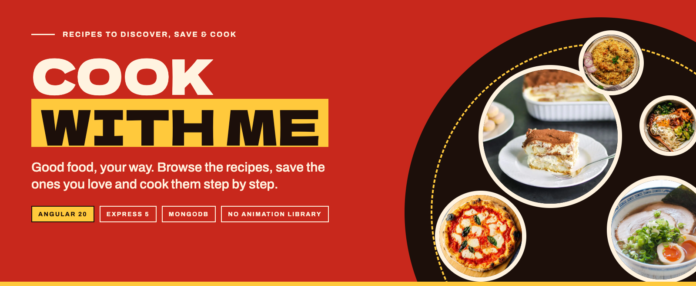
</p>

<p align="center">
  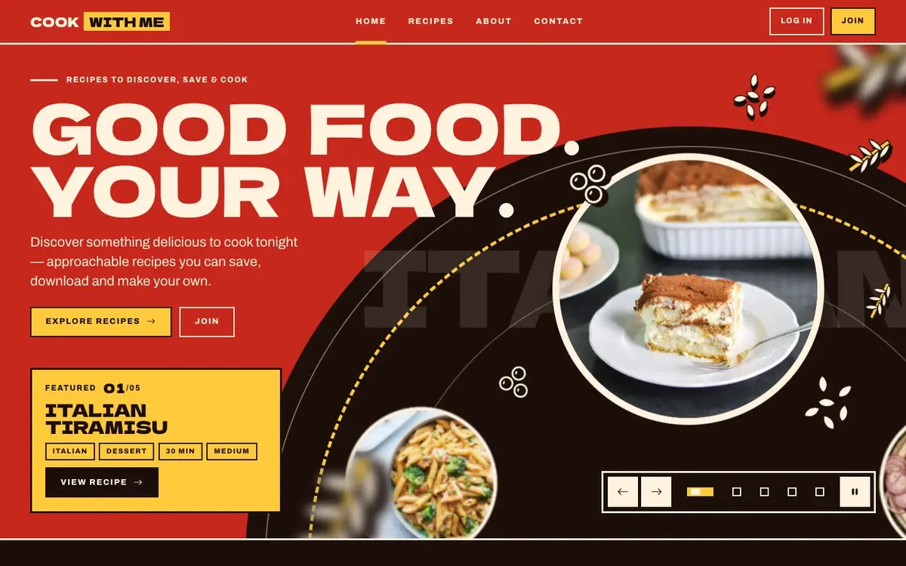
</p>

<p align="center">
  <a href="docs/reel/cook-with-me-reel-web.mp4">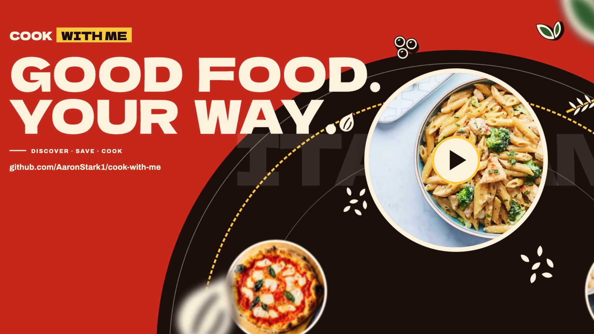</a>
  <br>
  <b><a href="docs/reel/cook-with-me-reel-web.mp4">▶ Watch the 45-second reel</a></b>
  <br>
  <sub>Also in <a href="docs/reel/cook-with-me-reel.mp4">1080p60</a> and <a href="docs/reel/cook-with-me-reel-vertical.mp4">vertical 9:16</a>, with sound</sub>
</p>

<p align="center">
  <b><a href="#see-it-cook">See it cook</a></b>
  &nbsp;·&nbsp; <a href="#the-reel">The reel</a>
  &nbsp;·&nbsp; <a href="#screens">Screens</a>
  &nbsp;·&nbsp; <a href="#the-look">The look</a>
  &nbsp;·&nbsp; <a href="#quick-start">Quick start</a>
  &nbsp;·&nbsp; <a href="#motion-system">Motion system</a>
  &nbsp;·&nbsp; <a href="#api-overview">API</a>
</p>

**Cook With Me** is a full-stack recipe app: browse a library of recipes, save the ones you love, and cook them step by step. It is an **Angular 20** frontend over an **Express 5 + MongoDB** API. It has an editorial look (tomato red, yolk yellow, flat colour and hard edges) and a motion system built only from CSS, the Web Animations API and View Transitions.

## See it cook

<sub>Filmed frame by frame from the running app on its real recipe library (see <a href="#readme-media">README media</a>).</sub>

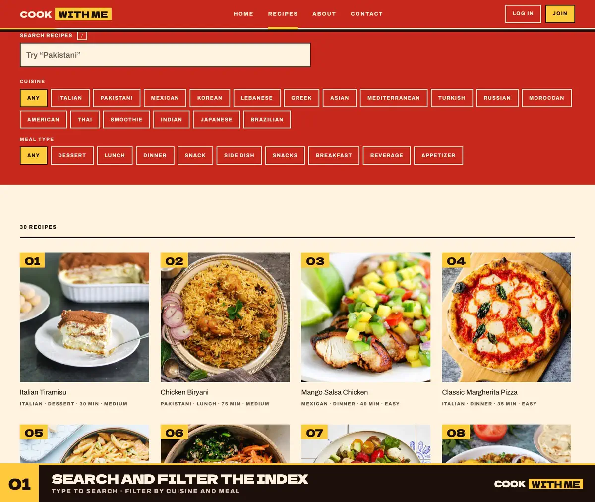

Search as you type, with the match highlighted in every title. Narrow the grid by cuisine and meal type. Tiles that no longer match leave, and the rest slide into place.

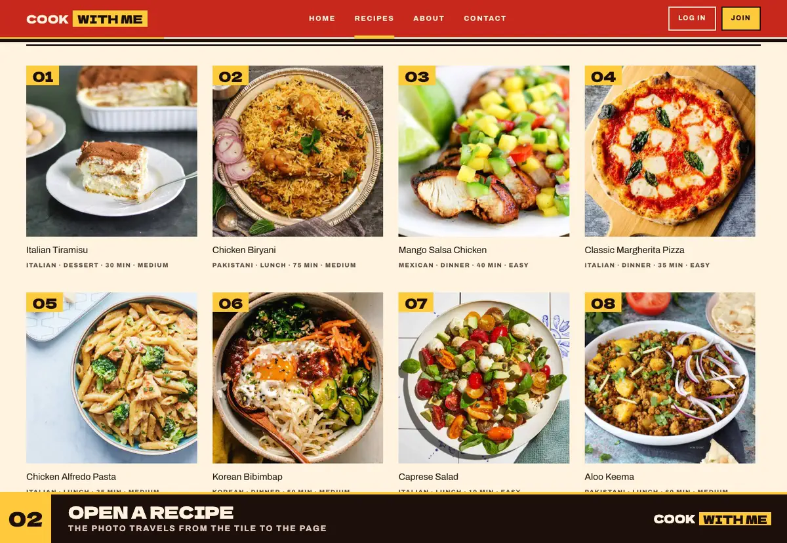

Open a recipe and its photo travels from the tile to the page. Prep time, cook time, servings and calories count up, with **Start cooking**, **Download PDF**, **Save** and **Share** one click away.

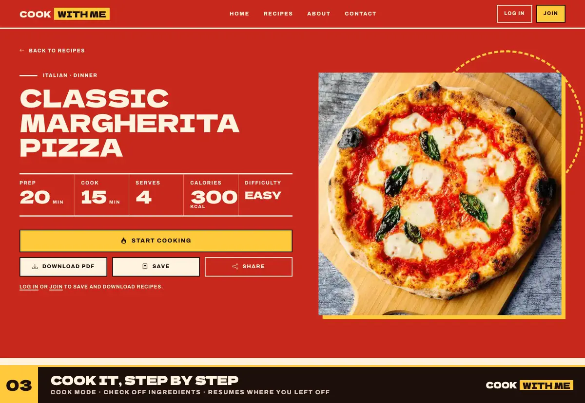

**Cook Mode** turns the method into full-screen steps that wipe from one to the next. Check off ingredients in the drawer as you go. Progress is kept per recipe, so it picks up where you left off, and it keeps the screen awake where the browser allows.

<p align="center">
  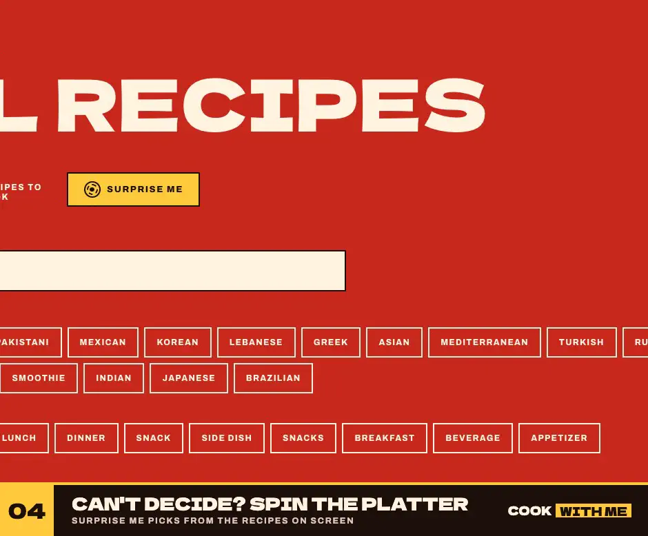
</p>

Can't decide? **Surprise me** spins a platter of the recipes currently on screen and serves one up.

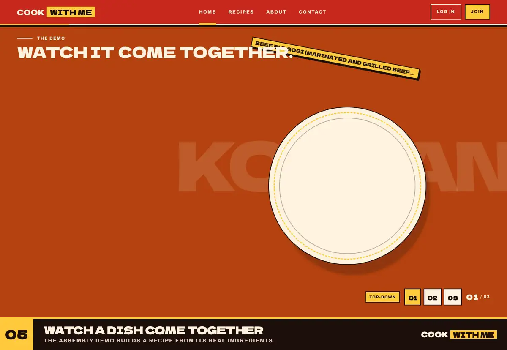

On the home page, the **Assembly Demo** builds a dish from its real ingredient list as you scroll. Each recipe has a single photo, so the camera angles are simulated, and it never claims otherwise.

## The reel

<table>
  <tr>
    <td width="64%" valign="top"><a href="docs/reel/cook-with-me-reel-web.mp4"></a></td>
    <td width="36%" valign="top"><a href="docs/reel/cook-with-me-reel-vertical.mp4">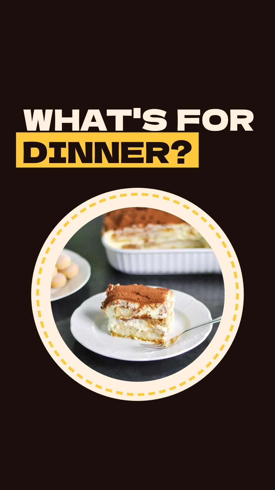</a></td>
  </tr>
  <tr>
    <td align="center"><sub><b><a href="docs/reel/cook-with-me-reel-web.mp4">16:9 web</a></b> · 1280×720, 30 fps, 8.8 MB &nbsp;|&nbsp; <a href="docs/reel/cook-with-me-reel.mp4">16:9 master</a> · 1920×1080, 60 fps, 18.5 MB</sub></td>
    <td align="center"><sub><b><a href="docs/reel/cook-with-me-reel-vertical.mp4">9:16 vertical</a></b> · 1080×1920, 30 fps, 23.3 MB</sub></td>
  </tr>
</table>

Forty-five seconds, with sound, filmed frame by frame from the running app and cut together with its own transitions. GitHub doesn't play videos from the repository inline, so each poster opens its MP4. How it's made is under [Reel](#reel).

## Screens

<table>
  <tr>
    <td width="33%"></td>
    <td width="33%">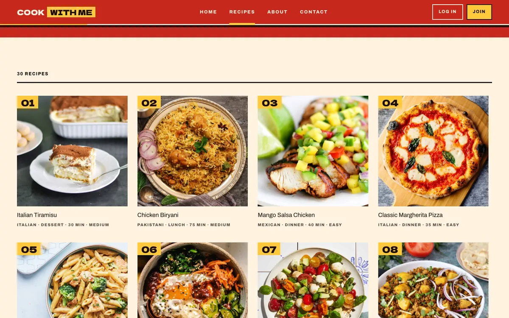</td>
    <td width="33%">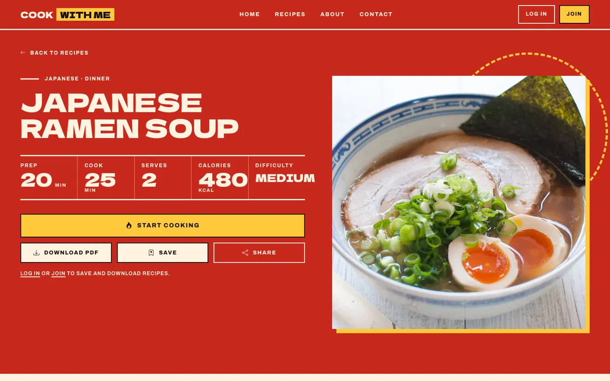</td>
  </tr>
  <tr>
    <td align="center"><sub>Home</sub></td>
    <td align="center"><sub>Recipe index</sub></td>
    <td align="center"><sub>Recipe</sub></td>
  </tr>
  <tr>
    <td>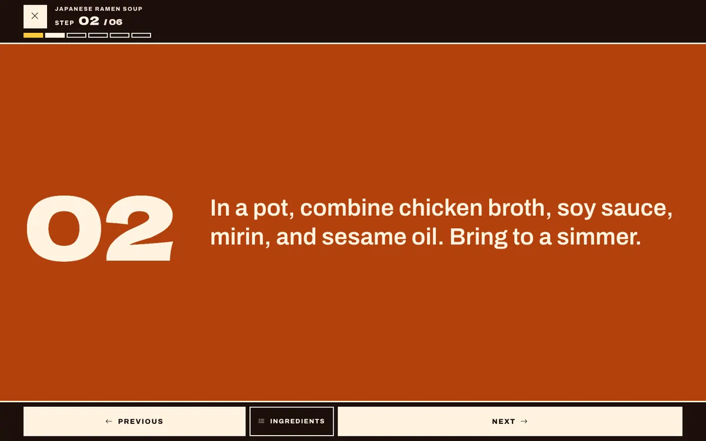</td>
    <td>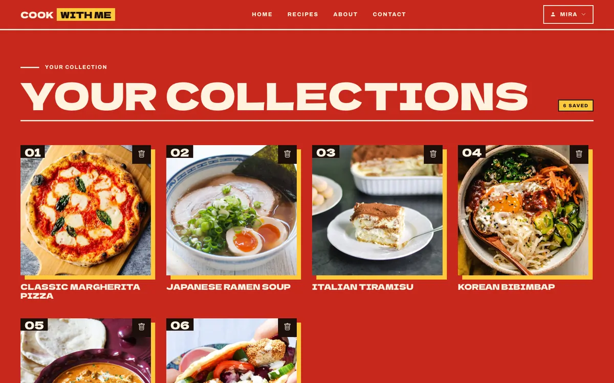</td>
    <td>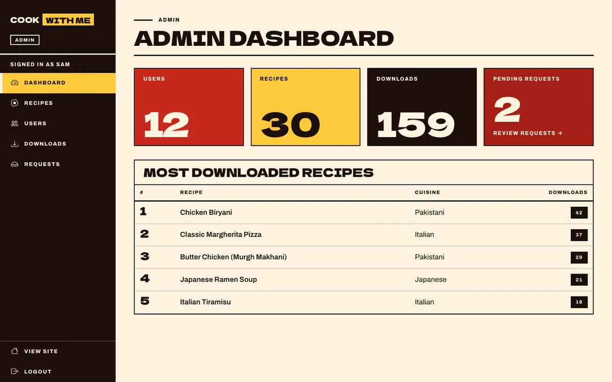</td>
  </tr>
  <tr>
    <td align="center"><sub>Cook Mode</sub></td>
    <td align="center"><sub>My collection <i>(sample data)</i></sub></td>
    <td align="center"><sub>Admin dashboard <i>(sample data)</i></sub></td>
  </tr>
</table>

## The look

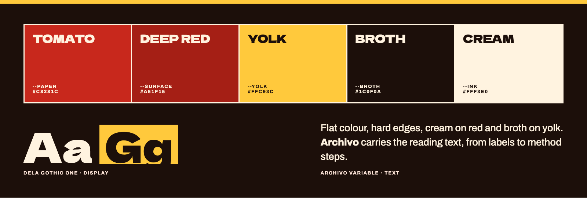

Flat colour and hard edges: no gradients, glows, glass or rounded pills. Circles appear only as the platter. Text is cream on red or broth, or broth on yolk or cream, and yellow is never used for text on red. The full rules are under [Design system](#design-system) and [Motion system](#motion-system).

## Quick start

```bash
# API (needs a MongoDB connection string in backend/.env, see Environment Variables)
cd backend && npm ci && cp .env.example .env && npm start      # http://localhost:3000

# App
cd frontend && npm ci && npm start                             # http://localhost:4200
```

## Project Structure

```
cook-with-me/
├── frontend/              # Angular 20 application
├── backend/               # Express.js REST API
├── docs/readme/           # README media (generated, see "README media")
├── docs/reel/             # the 45-second reel in three cuts (generated, see "Reel")
├── tools/readme-media/    # Playwright + ffmpeg script that films the README media
├── tools/showreel/        # films, composes, scores and encodes the reel
├── .github/               # CI workflow
└── README.md
```

## Frontend (Angular)

### Setup
```bash
cd frontend
npm ci
npm start
```
Runs on `http://localhost:4200` and talks to the API at `http://localhost:3000`.

### Configuration
The API base URL lives in `src/environments/`:

| File | Used for | `apiUrl` |
|------|----------|----------|
| `environment.ts` | `npm start` / development | `http://localhost:3000` |
| `environment.production.ts` | `ng build` (production) | `''` — same origin (`/api/...`). Set a full `https://` URL if the API is hosted elsewhere. |

### Scripts
```bash
npm test                                   # unit tests (Karma + Chrome)
npx ng test --watch=false --browsers=ChromeHeadlessCI   # headless / CI
npx ng build --configuration production
```

### Design system
The UI is a custom brand layer over Bootstrap's reset and grid (Bootstrap's JavaScript is no longer loaded).
- **Tokens and primitives** live in `src/styles.css`: palette (`--paper` tomato, `--ink` cream, `--surface`, `--yolk`, `--broth`, `--muted`),
  fonts (Dela Gothic One for display, Archivo for text — self-hosted from `@fontsource`, latin subset only), and shared classes
  (`.band--*`, `.btn-cwm`, `.tag`, `.photo`, `.state`/`.loader`, form/alert/table styles). Component CSS stays scoped next to each component.
- **Contrast rules:** cream on red or broth, broth on yolk or cream. Yellow is never used for text on red. Focus rings are a broth + yolk double ring so they show on every surface.
- **Home hero** (`components/hero-carousel`, with `hero-stage` and `hero-info`): a poster hero with a rotating "lazy-Susan" platter of up to
  five recipes taken from the API. One `turns` signal drives dish positions, platter rotation, active copy, position dots and the field colour.
  It auto-advances every ~5.2 s; any user action holds it for 6 s; it pauses on hover, focus, a hidden tab, the pause button and when less
  than 30 % of it is on screen, and it never autoplays under `prefers-reduced-motion`. With no recipes it renders a static hero with no dead links.
- Recipe photos fall back to a branded plate (`assets/plate.svg`) if an image URL fails (`appImgFallback` directive).

### Motion system
Motion is progressive enhancement over a complete static page: every hidden state is added by script at runtime, so a page without JS,
without `IntersectionObserver`/View Transitions, or with reduced motion is simply finished. No animation library is used — only CSS,
the Web Animations API, `IntersectionObserver`, the View Transitions API and Angular's `animate.enter` / `animate.leave`.

- **Tokens** — `src/motion.css` (easings, durations, reveal states, plate loader, skeletons, button press, check-offs, route-transition CSS,
  the global reduced-motion block), mirrored for scripted motion in `src/app/motion/tokens.ts`. `--ease-wipe` is a measured coverage curve
  (slow start, a rush, a long landing); `cover(t)` is the same curve in JS and a unit test keeps the two in agreement. Do not retune it.
- **The wipe** (`motion/wipe.ts`) — the leaving layer is covered along that curve while its content drifts 14 % of the width; incoming
  layers arrive with parallax from 50 % to 92 % of the run. Used by the hero colour change (970 ms), route transitions and Cook Mode
  steps (640 ms). Flat colour panels are *slid* out with the 6 px yolk edge attached, so the edge can never drift from the colour boundary.
- **Primitives** in `src/app/motion/`:
  `MotionPrefs` (live `reduced` signal — the only place components read the preference) ·
  `appReveal` (`rise`, `mask`, `wipe`, `rule`, `stagger`, `tile batch`; one shared observer) ·
  `appFlip` (grid re-ordering; removed items leave as inert ghosts, so the rendered list is always exactly the data) ·
  `appCountUp` and `<app-odometer>` (the real value stays in the DOM; the moving digits are decorative) ·
  `appCursorTag` · `appTypedPlaceholder` · `ScrollState` (one passive scroll listener outside NgZone) ·
  `ProgressStore` (versioned `cwm.<thing>.v1.<id>` keys in `localStorage`, 14-day pruning, in-memory when storage is blocked) ·
  `route-transition.ts` (chooses `wipe` / `morph` / `none` and sets `data-vt` on `<html>`) ·
  `AssemblyTimeline` (paused WAAPI tracks on one clock, driven by scroll or played).
- **Route transitions** — the page is the `root` view-transition snapshot and the sticky header has its own name, so the header never moves.
  Admin routes, same-route query changes, reduced motion and hidden tabs get no transition. A clicked recipe tile hands its photo to the
  detail page as a shared element; the tile also passes the record it already has through router state so the page can render at once.
- **Assembly Demo** (`components/assembly-demo`, lazy via `@defer`) — builds three fixed recipes on screen from their real ingredients.
  `showcase.config.ts` exports `SHOWCASE_RECIPE_IDS` (pin your own) and the deterministic `pickShowcase`. On wide, fine-pointer screens it is
  scroll-driven and pinned; elsewhere it plays once; under reduced motion it is a static assembled dish with instant angle buttons.
  Each recipe has **one** photo — the "angles" are a simulated camera, and no copy may claim otherwise.
- **Cook Mode** (`components/cook-mode`) and the **Surprise-me wheel** (`components/spin-overlay`) are lazy chunks opened on demand; both are
  native `<dialog>`s. Cook Mode honours `?cook=1`, resumes from `ProgressStore`, and requests a screen wake lock where available.
- **Rules of the house** — animate only `transform`/`translate`/`scale`/`rotate`, `opacity` and `clip-path`; flat colour and hard edges
  (no gradients, glows, glass or rounded pills); circles only for the platter motif; 3D only in the Assembly Demo and the hero's pointer
  tilt; every listener passive and outside NgZone; idle loops pause off-screen; component CSS stays under the 8 kB budget.
- **Reduced motion** — no intro, autoplay, bob, marquee, reveals, count-ups, FLIP, route transitions, wheel spin or inertia; wipes become
  instant swaps. It never removes information or function.
- **Bundle** — only the shell and Home are in the initial bundle; every other route is a `loadComponent` chunk.

### Features
- Browse & search recipes, filter by cuisine and meal type
- User registration & login (session kept in `sessionStorage`, only `username/email/role` — never the password hash)
- Save favorite recipes, download recipes as PDF, share a recipe link
- Cook Mode: a full-screen, step-by-step view with ingredient check-offs that resumes where you left off
- "Surprise me": spin a platter of the recipes currently on screen
- Profile page with editable name/email
- Admin area (recipes, users, downloads, testimony moderation, live dashboard) — guarded on the client **and** enforced by the API

## Backend (Express.js)

### Setup
```bash
cd backend
npm ci
cp .env.example .env   # then fill in your values
npm start
```

### Environment Variables
| Variable          | Required | Description |
|-------------------|----------|-------------|
| `MONGO_DB`        | yes      | MongoDB connection string |
| `JWT_KEY`         | yes      | Secret for signing JWTs — use a long random value. The server refuses to start without it. |
| `PORT`            | no       | Port to listen on (default `3000`) |
| `FRONTEND_URL`    | no       | Comma-separated browser origins allowed by CORS (default `http://localhost:4200`) |
| `JWT_EXPIRES_IN`  | no       | Token lifetime, e.g. `1h`, `1d` (default `1d`) |

### Scripts
```bash
npm start                  # run the API
npm test                   # integration tests (no database needed)
npm run migrate:users      # one-off, see below
```

### Admin accounts
Registration always creates a regular user (`role: "User"`). To create an admin, set `role` to `"Admin"` on a
user document directly in MongoDB (the old lowercase `"admin"` is still recognised).

> **Upgrading an existing database?** Login no longer accepts plaintext passwords, and roles are now `User` / `Admin`.
> Run `npm run migrate:users` once to hash any plaintext passwords (e.g. a manually seeded admin) and normalise role casing.

### API overview
| Access | Endpoints |
|--------|-----------|
| Public | `POST /api/registration`, `POST /api/login`, `GET /api/allRecipes`, `GET /api/viewRecipe/:id`, `GET /api/relatedRecipe?cuisine=`, `GET /api/getApprovedTestimony`, `GET /health` |
| Signed-in user | `PATCH /api/updateProfile`, saved recipes (`POST /api/savedRecipe/:id`, `GET /api/getSavedRecipes`, `DELETE /api/deleteSavedRecipe/:id`), downloads (`POST /api/addDownload/:id`, `GET /api/getDownload`, `DELETE /api/deleteDownload/:id`), `POST /api/addTestimony` |
| Admin only | `GET /api/getAllUsers`, `GET /api/getDownloadedRecipesList`, `GET /api/getTestimony`, `PATCH /api/updateTestimony/:id`, `POST /api/addRecipe`, `PUT /api/updateRecipe/:id`, `DELETE /api/deleteRecipe/:id` |

Errors are JSON: `{ "message": "...", "errors": [{ "field", "message" }] }` (the `errors` list appears on validation failures).

## Tech Stack
- **Frontend**: Angular 20, Bootstrap 5, jsPDF (loaded on demand)
- **Backend**: Express.js 5, Mongoose 9, JWT, bcrypt, express-validator, express-rate-limit
- **Database**: MongoDB Atlas
- **CI**: GitHub Actions — backend tests + audit, frontend build + tests + audit

## README media

Everything under `docs/readme/` is filmed from the running app by [`tools/readme-media`](tools/readme-media/readme-media.mjs): the title card, the brand sheet, the animated WebP clips and the screens. It follows the same approach as the SpecShield showreel. A virtual clock is injected into the page, so timers, `requestAnimationFrame`, CSS and WAAPI animations and View Transitions only advance when the script steps them. Each frame is scripted input, then one step, then a screenshot, so every run reproduces the same clips.

```bash
# with the API on :3000 and the app on :4200
cd tools/readme-media && npm install
node readme-media.mjs                 # everything
node readme-media.mjs hero cook       # just these clips
node readme-media.mjs --sheets browse # plus a contact sheet in out/ for review
```

Recipe photos are cached in `out/cache` on the first run. Signed-in screens (My collection, Admin) use a fake session plus sample responses, and the script answers every write request itself, so filming never touches your database. It uses your installed Chrome, falling back to Playwright's Chromium.

### Reel

`docs/reel/` holds the 45-second reel, built by [`tools/showreel`](tools/showreel/timeline.mjs) in three cuts: `cook-with-me-reel.mp4` (the 1080p60 master), `cook-with-me-reel-web.mp4` (720p30, under 10 MB, linked at the top of this page) and `cook-with-me-reel-vertical.mp4` (1080×1920, for social), plus `cook-with-me-reel-thumb.jpg` and `cook-with-me-reel-vertical-cover.jpg`. The shots are filmed from the app frame by frame under the same kind of virtual clock (180 subframes a second, averaged into motion blur), then a WebGL compositor cuts them together with the app's own transitions (its field wipe, a plate iris, a deal of ingredient tickets, the platter spin) and a score synthesised to the picture. `timeline.mjs` is the edit: every cut, click and sound cue is timed there.

```bash
# with the app on :4200 (the API is only needed once, to record the fixtures)
cd tools/showreel && npm install
npm run fixtures                       # GET-only: recipes, one recipe page, related recipes; photos to out/cache
npm run capture                        # film the 16:9 shots          (-- --aspect 9x16 for the vertical cut)
npm run render                         # compose, score and encode     (-- --aspect 9x16)
npm run beats                          # review: a frame per beat on a contact sheet
node verify.mjs                        # the acceptance checks: specs, loudness, sync, colours, determinism
```

*Filmed from the running app. API responses are served from fixtures recorded from the real API, and save responses are mocked. Recipe photos: [DummyJSON](https://dummyjson.com).*
